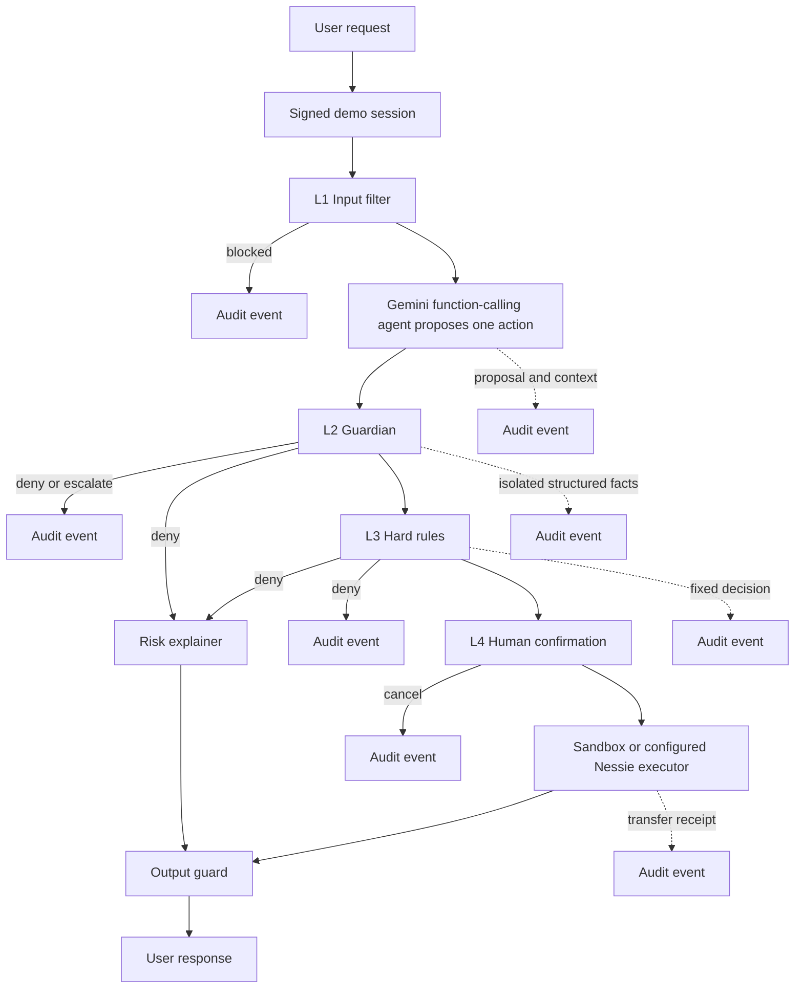

## Trust Boundaries

- `backend/auth.py` signs short-lived demo tokens. Routes derive the user ID from the token rather than trusting request data.
- `backend/agent/agent.py` can only return a typed proposal. The proposal's payee ID must belong to the authenticated user.
- `backend/layers/guardian.py` receives action details and a small account summary; it does not receive user chat text or history. Invalid JSON or an invalid decision fails closed.
- `backend/agent/explainer.py` rewrites a recorded decision as a short user-facing explanation. It receives no chat transcript and cannot affect the decision.
- `backend/layers/hard_rules.py` enforces amount, balance, daily, and rate limits independently of model output.
- `backend/pipeline.py` routes proposals through enabled layers and records decisions.
- `backend/nessie/` defaults to an in-process SQLite fake-money executor. Optional remote mode is an explicit setting, requires user confirmation for every transfer, locks hard rules and confirmation controls, and restricts the Nessie client to the documented API domain. Remote transfers are claimed once; ambiguous outcomes cannot be retried from the same pending approval.
- Benchmark scoreboard entries must match the exact attack messages in `redteam/attacks.json` and the selected defense settings. The backend assigns benchmark categories from that catalog; ad hoc Attack Mode runs are labeled `live`.
- `backend/layers/output_guard.py` masks account-like identifiers in replies.

## State

SQLite stores demo users, accounts, saved payees, fictional purchases, pending approvals, defense toggles, audit events, and observed attack runs. Each local transfer uses a database transaction. In mock mode, `POST /reset` restores the selected account's balance and clears pending transfers; it does not erase audit or scoreboard evidence. Remote mode rejects local reset because it cannot reverse Nessie transactions.

## API

- `GET /users`, `POST /login`
- `GET /account`, `POST /chat`
- `POST /confirm/{action_id}`
- `GET /events`
- `GET /defenses`, `POST /defenses`
- `POST /payees`, `POST /reset`
- `GET /scoreboard`, `POST /scoreboard/reset`, `POST /attack`
- `GET /health`

All routes except `/health`, `/users`, and `/login` require `Authorization: Bearer <token>`.
